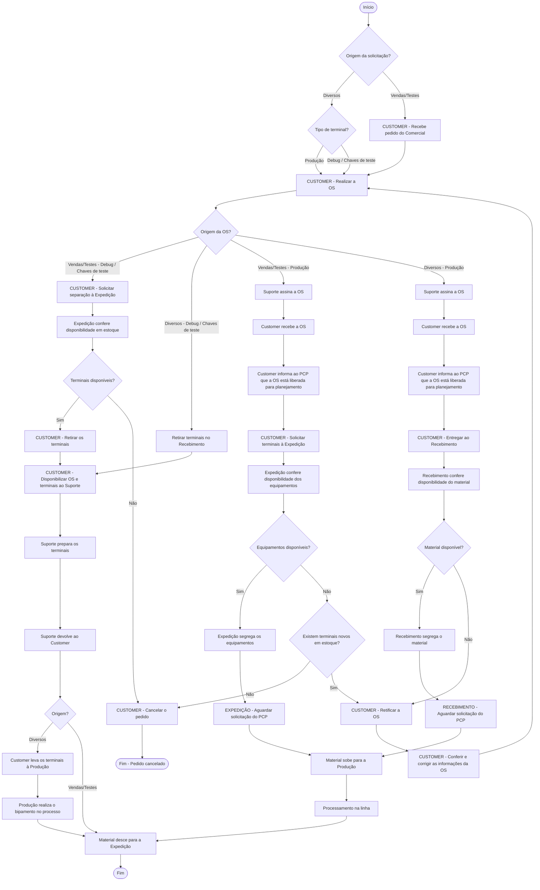

# Fluxo da OS — processo operacional

Transcrição em texto de `fluxo-os.png`. Em caso de dúvida sobre a transcrição, o PNG é a referência original.

Este fluxograma descreve o **processo operacional completo**, incluindo etapas físicas (retirada e movimentação de material) e de áreas que não necessariamente operam no sistema (Comercial, PCP, linha de produção). Ele não é uma máquina de estados: não usa os códigos de status do sistema.

## Diagrama

## Classificação da OS

A trilha é definida por duas dimensões:

| Origem \ Tipo de terminal | Debug / Chaves de teste | Produção |
|---|---|---|
| **Vendas/Testes** (pedido do Comercial) | Trilha A | Trilha C |
| **Diversos** | Trilha B | Trilha D |

## Trilhas

### Trilha A — Vendas/Testes, Debug / Chaves de teste
1. Customer solicita separação à Expedição.
2. Expedição confere disponibilidade em estoque.
3. Terminais disponíveis? **Não** → Customer cancela o pedido (fim). **Sim** → Customer retira os terminais.
4. Segue para a etapa do Suporte.

### Trilha B — Diversos, Debug / Chaves de teste
1. Retirar terminais no Recebimento (ator não indicado no diagrama).
2. Segue para a etapa do Suporte.

### Etapa do Suporte (trilhas A e B)
1. Customer disponibiliza OS e terminais ao Suporte.
2. Suporte prepara os terminais e devolve ao Customer.
3. Origem **Diversos** → Customer leva os terminais à Produção → Produção realiza o bipamento no processo.
4. Material desce para a Expedição (fim).

### Trilha C — Vendas/Testes, Produção
1. Suporte assina a OS → Customer recebe a OS → Customer informa ao PCP que a OS está liberada para planejamento.
2. Customer solicita terminais à Expedição; Expedição confere disponibilidade.
3. Equipamentos disponíveis? **Sim** → Expedição segrega e aguarda solicitação do PCP.
   **Não** → existem terminais novos em estoque? **Sim** → retificação da OS. **Não** → Customer cancela o pedido (fim).
4. Material sobe para a Produção → processamento na linha → material desce para a Expedição (fim).

### Trilha D — Diversos, Produção
1. Suporte assina a OS → Customer recebe a OS → Customer informa ao PCP que a OS está liberada para planejamento.
2. Customer entrega ao Recebimento; Recebimento confere disponibilidade do material.
3. Material disponível? **Sim** → Recebimento segrega e aguarda solicitação do PCP. **Não** → retificação da OS.
4. Material sobe para a Produção → processamento na linha → material desce para a Expedição (fim).

## Desfechos

| Desfecho | Quando ocorre |
|---|---|
| Fim | Material desce para a Expedição |
| Pedido cancelado | Trilha A sem terminais disponíveis; trilha C sem equipamentos e sem terminais novos em estoque |
| Retificação | Trilha C com terminais novos em estoque; trilha D sem material. Customer retifica, confere e corrige a OS, e o fluxo recomeça em "Realizar a OS" |
